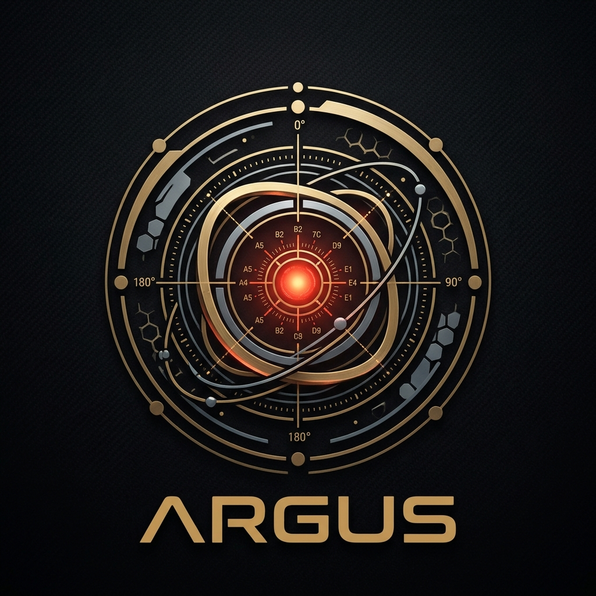
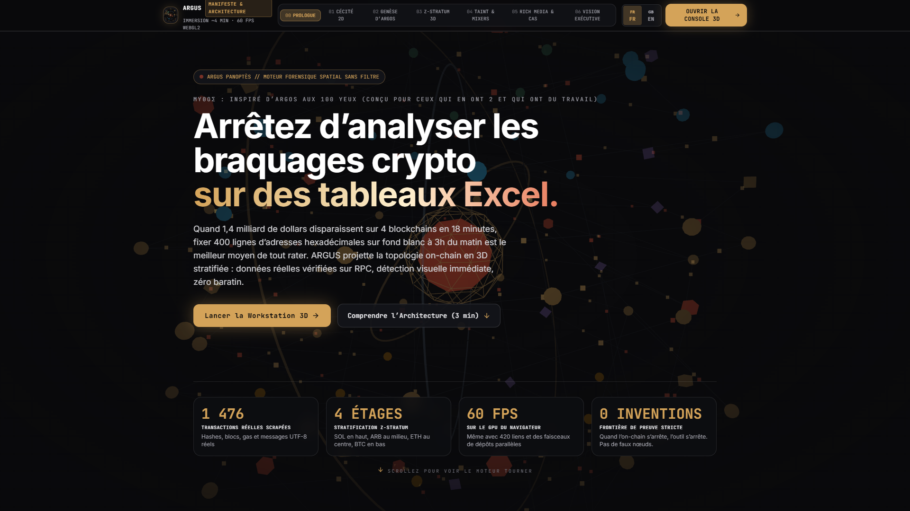
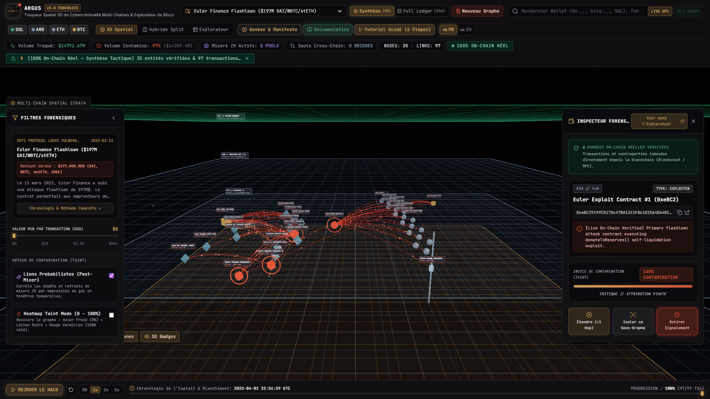

<div align="center">

<a href="#-argus--advanced-forensic-spatial-workstation">
  
</a>

# 👁️ ARGUS // Advanced Forensic Spatial Workstation
### *3D Multi-Chain Spatial Forensic & Cybercrime Intelligence Tracer*

[](https://www.typescriptlang.org/)
[](https://react.dev/)
[](https://threejs.org/)
[](https://vitejs.dev/)
[](https://tailwindcss.com/)
[](LICENSE)

<br/>

<p align="center">
  
</p>

**ARGUS** est une station de travail forensic Web3 de nouvelle génération qui transcende les explorateurs 2D traditionnels pour projeter les flux criminels multi-chaînes dans un **espace volumétrique 3D stratifié**.

De la compromission de validateurs aux attaques de flashloan et aux réseaux d'épluchage (*peel chains*) de **Lazarus Group**, ARGUS retrace les trajectoires de fonds vérifiées à 100 % sur **Solana**, **Arbitrum One**, **Ethereum L1** et **Bitcoin**.

[Démarrage Rapide](#-démarrage-rapide) • [Cas d'Étude Réels](#-les-5-cas-détude-historiques) • [Architecture 3D](#-stratification-spatiale-multi-chaînes) • [Spécifications Techniques](#-stack-technique)

</div>

---

## 📸 Aperçu de la Station de Travail

<div align="center">
  
  <p><em>Station de travail ARGUS : Visualisation spatiale 3D temps réel, traçage de contamination (Taint Engine) et Ledger d'audit forensic.</em></p>
</div>

---

## ⚡ Pourquoi ARGUS ?

Les outils forensic traditionnels représentent les transactions blockchain sous la forme de graphes nodaux 2D plats. Dès qu'un hack dépasse quelques dizaines de transferts, ces graphes se transforment en un « plat de spaghettis » illisible :
- **Perte de la dimension inter-chaînes** : impossibilité de distinguer visuellement le passage d'une L1 à un L2 ou un réseau UTXO comme Bitcoin.
- **Confusion temporelle** : pas de restitution fluide de la cinétique des flux.
- **Absence de décodage contextuel** : les messages de négociation on-chain et métadonnées restent enfouis dans les hexadécimaux bruts.

**ARGUS résout ce problème par trois ruptures fondamentales :**
1. **La Stratification Spatiale Multi-Chaînes ($Y$-Planes)** : Chaque écosystème blockchain possède son propre plan horizontal d'altitude dédiée. Les ponts inter-chaînes (THORChain, Wormhole, RenBridge) deviennent des **piliers verticaux lumineux** reliant physiquement les strates.
2. **La Sémantique Géométrique Différenciée** : Chaque type d'acteur possède une signature 3D unique (icosaèdre d'exploiter, anneau d'accrétion de mixer, prisme de DEX, cube d'institution).
3. **Le Moteur Forensic Temps Réel** : Score de contamination dynamique (Taint Score de 0 à 100 %), analyse de décomposition temporelle (Timeline Scrubber 24-step) et décodeur UTF-8 natif des messages de hackers.

---

## 🌐 Stratification Spatiale Multi-Chaînes

Dans la scène 3D d'ARGUS, l'espace vertical ($Y$) est rigoureusement assigné selon la hiérarchie des couches d'exécution :

```
                        ▲  Altitude Y
                        │
 [SOL] Solana Mainnet   │  Y = +240  ───  Hautes performances, flux SPL & Wormhole
                        │                 ▲
 [ARB] Arbitrum One L2  │  Y = +120  ───  Rollup Optimiste, adresses d'épluchage L2
                        │                 ▲ (Faisceaux verticaux / Bridges)
 [ETH] Ethereum L1      │  Y =    0  ───  Plan d'Origine / DeFi, Flashloans & Mixers
                        │                 ▼ (Swaps THORChain / RenBridge)
 [BTC] Bitcoin Network  │  Y = -120  ───  Réseau UTXO, Peel Chains & Wasabi CoinJoin
                        ▼
```

### Géométrie Sémantique des Entités

| Entité | Forme Géométrique 3D | Couleur Tactique | Description Forensique |
| :--- | :--- | :--- | :--- |
| **Exploiteur / Hacker** | **Icosaèdre Pulsant** + Halo | `Signal Vermilion` (`#E04F33`) | Adresses sources ou de consolidation du pirate. Émet des impulsions de particules proportionnelles au volume volé. |
| **Mixeur ZK / Anonymiseur** | **Disque d'Accrétion Gravitationnel** | `Electric Violet` (`#9D7CD8`) | Tornado Cash, Railgun, Blender.io, Wasabi CoinJoin. Liens probabilistes pointillés vers les adresses de retrait. |
| **Pont Cross-Chain** | **Balise Cylindrique & Faisceau Laser** | `Laser Cyan` (`#28A0F0`) | Routeurs THORChain, contrats Wormhole Portal, ponts d'inbox Arbitrum. Connecte deux strates spatiales. |
| **DEX / Liquidité** | **Octaèdre en Rotation (Prisme)** | `Cyan Aqua` (`#00F5D4`) | Uniswap, Curve, Balancer, Camelot. Lieux de conversion d'urgence ou de flashloan. |
| **CEX / Institutionnel** | **Prisme Hexagonal Massif** | `Warm Brass` (`#D4A359`) | Hot wallets Binance, Coinbase, OKX ou portefeuilles de garde institutionnels. |
| **EOA / Utilisateur** | **Sphère Slate** | `Slate Gray` (`#8C9BAE`) | Portefeuilles individuels, victimes ou adresses d'intermédiation. |

---

## 🔬 Les 5 Cas d'Étude Historiques

ARGUS embarque 5 archives forensiques complètes, basées sur des données on-chain réelles, nettoyées et enrichies :

<div align="center">
  
</div>

### 1. Bybit Safe Multisig Exploit — $1.46 Milliard (Février 2025)
* **Vecteur** : Trojan JavaScript injecté sur la machine d'un développeur Safe{Wallet} lors d'un transfert de routine.
* **Mécanisme** : Appel malveillant `DELEGATECALL` modifiant la mastercopy du Safe (`0x1Db9...FCF4`) vers un contrat corrompu (`0xbDd0...9516`), déclenchant le siphonnage de 401 347 ETH.
* **Multi-Chaînes** : Plus de $900M blanchis via **THORChain Router V4** vers le réseau Bitcoin (`bc1q...`), dispersion en chaînes d'épluchage (*peel chains*) et mixage **Wasabi CoinJoin** ($Y = -120$), avec dérivation vers **Arbitrum L2** ($Y = +120$) et **Solana** ($Y = +240$).

### 2. Ronin Bridge (Axie Infinity) — $624 Millions (Mars 2022)
* **Vecteur** : Compromission de 5 des 9 clés privées des validateurs Sky Mavis / Axie DAO via spear-phishing (fausse offre d'emploi PDF).
* **Mécanisme** : Retrait non autorisé de 173 600 ETH et 25.5M USDC sur le contrat du pont Ronin sur Ethereum (`0x1A2a...8872`).
* **Multi-Chaînes** : Répartition par tranches de 100 ETH sur Tornado Cash, suivie de transferts massifs vers **Blender.io** (premier mixeur sanctionné par l'OFAC) et **THORChain** pour conversion en Bitcoin natif ($Y = -120$).

### 3. Euler Finance Flashloan Logic Vulnerability — $197 Millions (Mars 2023)
* **Vecteur** : Faille de conception dans la fonction `donateToReserves()` du contrat d'eTokens sans vérification de ratio de santé.
* **Mécanisme** : Flashloan Balancer ($30M DAI), démultiplication du levier via création notionnelle de tokens depuis l'adresse de frappe `EVM Zero / Mint Engine (0x00...00)` totalisant plus de **$5.67 Milliards**, auto-liquidation et extraction.
* **Dénouement & Décodage On-Chain** : Au **bloc #16885400**, le pirate envoie son message de capitulation encodé en UTF-8 (*« we want to make all full easy for all those affected... »*), menant à la **restitution intégrale de 100 % des fonds** le 3 avril 2023.

### 4. FTX Chapter 11 Accounts Drainer — $477 Millions (Novembre 2022)
* **Vecteur** : Extraction illégitime des portefeuilles chauds de FTX quelques heures après la déclaration de faillite (Chapter 11), suspectée via fuite de clés ou SIM-swap interne.
* **Mécanisme** : Vidage simultané des coffres **Solana** ($Y = +240$) et **Ethereum** ($Y = 0$). Swaps paniques sur Uniswap/Curve pour échapper au gel de Tether ($31M USDT bloqués) et Paxos ($20M PAXG bloqués).
* **Multi-Chaînes** : Franchissement vers Ethereum via **Wormhole Portal**, puis exfiltration de plus de $300M en Bitcoin natif via **RenBridge Gateway** vers l'adresse réceptrice officielle documentée par la justice américaine (`bc1qa5wk...`) et dispersion dans **ChipMixer** ($Y = -120$).

### 5. Wormhole Solana Portal Bridge — $326 Millions (Février 2022)
* **Vecteur** : Faille d'injection d'instructions dans `verify_signatures` du pont Wormhole sur Solana.
* **Mécanisme** : Le pirate usurpe le compte `sysvar::instructions` pour valider un faux VAA (Verified Action Approval), frappant 120 000 wETH sur Solana sans collatéral avant de racheter de vrais ETH sur le contrat Ethereum.
* **Multi-Chaînes** : Saut vertical direct entre **Solana** ($Y = +240$) et **Ethereum** ($Y = 0$).

---

## 🛠️ Stack Technique

```
┌─────────────────────────────────────────────────────────────┐
│                    ARGUS PRESENTATION LAYER                 │
├───────────────────────────────┬─────────────────────────────┤
│   Landing Page Scrollytelling │   Forensic Workstation      │
│   • Cinematic 3D Scroll Hero  │   • Multi-Chain 3D Canvas   │
│   • Interactive Geometry Deck │   • Classic Ledger Table    │
│   • Interactive Taint Lab     │   • Timeline Scrubber       │
│   • 60 FPS Procedural Cinema  │   • Hex Message Inspector   │
├───────────────────────────────┴─────────────────────────────┤
│                    3D VOLUMETRIC ENGINE                     │
│   • Three.js r170 (Custom Shader Materials, Bezier Links)   │
│   • Dynamic Stratified Multi-Grid System (SOL, ARB, ETH, BTC│
│   • Raycasting & Camera Interpolation (Fly-to Nodes)        │
├─────────────────────────────────────────────────────────────┤
│                     FORENSIC CORE & STATE                   │
│   • Zustand Reactive Store (Isolate Sub-Graph, Taint Modes) │
│   • Archive Service (Tactical 60 FPS vs Full Ledger)        │
│   • Hex UTF-8 Parser (On-Chain Hacker Communications)       │
└─────────────────────────────────────────────────────────────┘
```

---

## 🚀 Démarrage Rapide

### Prérequis
- [Node.js](https://nodejs.org/) v18.0.0 ou supérieur
- [npm](https://www.npmjs.com/) ou [pnpm](https://pnpm.io/)

### Installation

```bash
# 1. Cloner le dépôt officiel
git clone https://github.com/dudutti/Argus.git
cd Argus

# 2. Installer les dépendances
npm install

# 3. Lancer le serveur de développement local
npm run dev
```

Ouvrez votre navigateur sur `http://localhost:5173/` :
- **`/`** : Landing Page Scrollytelling interactive avec simulateurs procéduraux 60 FPS.
- **`/workstation`** : Station de travail forensique complète avec sélection des 5 cas d'étude.

### Construction pour la Production

```bash
npm run build
npm run preview
```

---

## 📁 Architecture du Projet

```
Argus/
├── docs/                         # Documentation visuelle et kits médias
│   └── images/                   # Logos haute résolution (SVG animé, JPG) et captures d'écran
├── public/
│   ├── archives/                 # Jeux de données JSON réels vérifiés on-chain
│   │   ├── bybit-safe-exploit-2025.json
│   │   ├── euler-flashloan-exploit-2023.json
│   │   ├── ftx-accounts-drainer-2022.json
│   │   ├── ronin-bridge-exploit-2022.json
│   │   └── wormhole-bridge-exploit-2022.json
│   ├── argus-orbital-nexus.svg   # Logo vectoriel animé en temps réel
│   └── media/                    # Captures d'écran et graphiques haute résolution
├── scripts/                      # Scripts d'enrichissement et d'ingestion on-chain
│   └── enrich_crosschain_archives.py
├── src/
│   ├── components/               # Composants React de l'interface
│   │   ├── landing/              # Composants Scrollytelling de la Landing Page
│   │   │   ├── ArgusLandingPage.tsx
│   │   │   ├── InteractiveGeometryDeck.tsx
│   │   │   ├── InteractiveTaintLab.tsx
│   │   │   └── RichMediaShowcase.tsx
│   │   ├── ClassicBlockExplorer.tsx # Explorateur de blocs & table de ledger
│   │   ├── LeftFilterPanel.tsx   # Filtres de contamination et seuils de valeur
│   │   ├── RightInspectorPanel.tsx # Inspecteur de nœud / transaction et call data
│   │   └── TimelineScrubber.tsx  # Barre chronologique 24 étapes
│   ├── engine/                   # Moteur 3D spatial Three.js
│   │   └── AetherScene3D.tsx     # Rendu des strates, nœuds volumétriques et liens Bézier
│   ├── services/                 # Services d'archives, RPC et indexeurs
│   │   ├── archiveService.ts
│   │   └── rpcService.ts
│   ├── store/                    # État global Zustand
│   │   └── useForensicStore.ts
│   ├── types/                    # Définitions TypeScript forensiques
│   │   └── forensics.ts
│   └── utils/
│       └── hexUtils.ts           # Décodeur UTF-8 / Hexadécimal on-chain
├── tailwind.config.js
├── vite.config.ts
├── LICENSE
└── package.json
```

---

## 🔍 Fonctionnalités Forensiques Clés

* **Mode Heatmap Taint ($0 - 100\%$)** : Coloration adaptative du graphe du jaune ocre au rouge vermillon éclatant selon le taux d'infection criminelle résiduelle.
* **Isolateur de Sous-Graphe (2 Hops)** : Isole instantanément l'entourage immédiat d'une entité suspecte pour éliminer le bruit visuel.
* **Navigation par Strates** : Boutons de caméra dédiés (`SOL`, `ARB`, `ETH`, `BTC`) permettant à la caméra orbitale de s'aligner précisément sur l'altitude de la chaîne choisie.
* **Inspecteur de Call Data & Décodeur UTF-8** : Permet de lire directement dans la table de transactions les correspondances échangées on-chain entre hackers et protocoles.

---

## 📜 Licence & Avertissement Légal

Ce projet est distribué sous licence **MIT**.  
Toutes les adresses de portefeuilles, transactions, hashs et contrats inclus dans les archives sont des données publiques immuables issues des registres décentralisés Ethereum, Bitcoin, Solana et Arbitrum. Ce logiciel est conçu à des fins exclusives de recherche académique, d'audit de sécurité, de formation en cyberdéfense et d'investigation forensique Web3.

---

<div align="center">
  <sub>Développé avec passion pour l'investigation Web3 et la transparence décentralisée.</sub>
</div>
